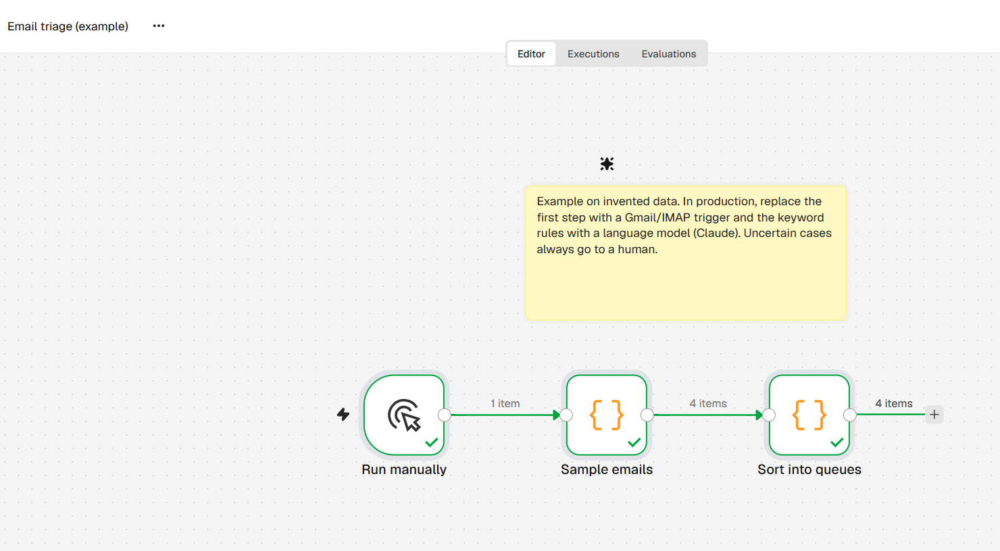
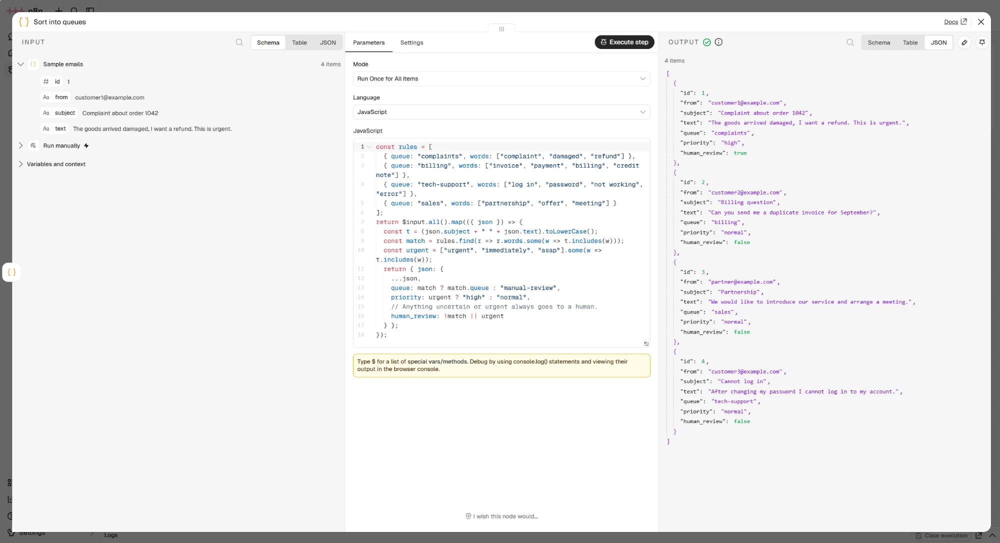

# Email triage

## Problem
A shared support mailbox receives everything in one stream. Someone has to read each message and route it to the right team by hand.

## Flow
`Run manually → Sample emails → Sort into queues`

Output per email: `queue` (complaints / billing / tech-support / sales / manual-review), `priority` and `human_review`.

## How to run
Import `workflow.json` into n8n and click **Execute workflow**. No credentials needed.

## Rules and risks
- An uncertain email (no rule matches) and an urgent email both get `human_review = true`.
- The rules are keywords. For production, replace them with a model and measure accuracy on a sample.

## Time saved (illustrative calculation)
Assumption: 1,200 emails a month × 1.5 min of manual sorting = 30 h. If 70% are sorted automatically, about 21 h a month are released. The real figure must be measured against a baseline before go-live.
