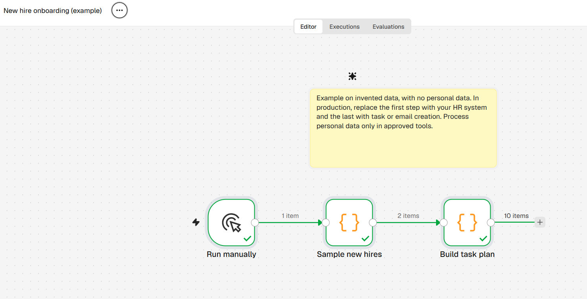
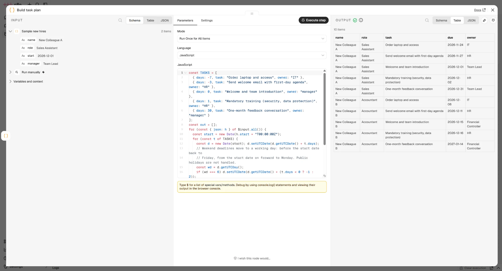

# HR onboarding

## Problem
At each start date HR has to remember tasks for IT, the manager and themselves (equipment, welcome, training). Deadlines get lost in email.

## Flow
`Run manually → Sample new hires → Build task plan`

Output: tasks with a due date (relative to the start date) and an owner.

Due dates always fall on a working day. A date that lands on a weekend moves to the previous Friday (tasks before the start date) or to the following Monday (tasks from the start date on). Public holidays are out of scope.

## How to run
Import `workflow.json` into n8n and click **Execute workflow**. No credentials needed.

## Data protection
The example uses invented names only. In production, personal data is processed only in approved tools and is not sent to language models.

## Time saved (illustrative calculation)
Assumption: 10 starters a month × 60 min of planning and reminders = 10 h. If the plan is generated automatically, about 8 h a month are released.
