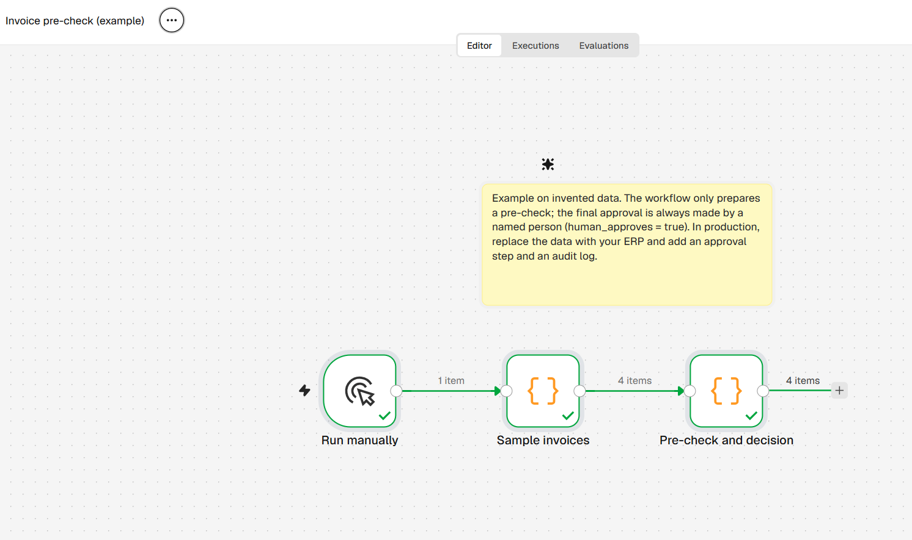
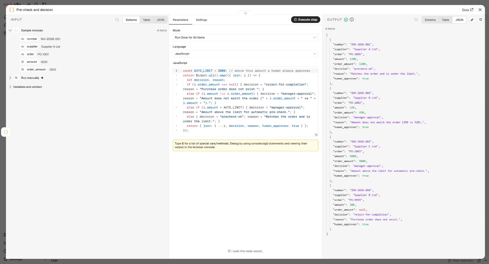

# Invoice pre-check

## Problem
An accountant manually compares every invoice with its purchase order and sends it for approval by email. It is slow and error-prone.

## Flow
`Run manually → Sample invoices → Pre-check and decision`

Output: `decision` (precheck-ok / manager-approval / reject-for-completion), `reason` and `human_approves`.

## How to run
Import `workflow.json` into n8n and click **Execute workflow**. No credentials needed.

## Controls and risks
- The workflow **does not approve** anything. It only prepares a pre-check; the final approval is made by a named person.
- Above the limit (2,000 € in the example) an invoice always goes to a manager.
- In a SOX environment you would add change control, access rights and an audit log.
- **Two-way match only.** The invoice is compared with the purchase order alone. In practice a goods receipt is checked too (3-way match), which this example does not do.
- **No duplicate check.** The same invoice arriving twice is not detected. A real version needs a lookup on supplier and invoice number.
- **Exact amount comparison.** Any difference counts as a mismatch. Real processes need tolerances (for example a small percentage or a fixed amount for rounding, freight or currency effects).
- **The saving is comparison time only.** The estimated hours cover matching, not approval. A person still approves every invoice, so the approval effort is not reduced.

## Time saved (illustrative calculation)
Assumption: 400 invoices a month × 8 min of manual matching = 53 h. If 80% are pre-checked automatically, about 43 h a month are released.
